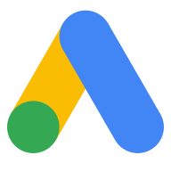
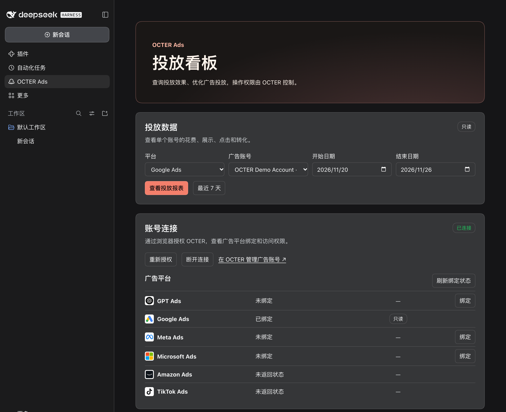
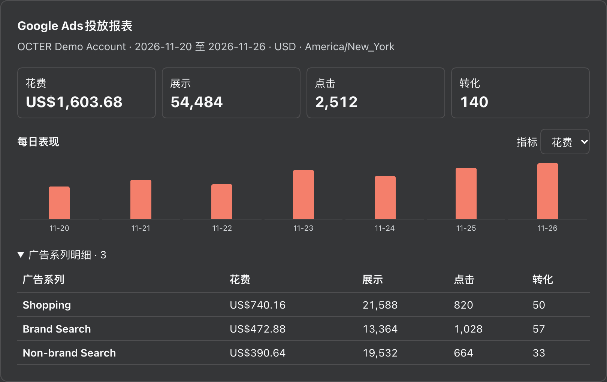

# OCTER Ads for DeepSeek Harness


[中文](README.md)

**Free-forever ad management and optimization.** OCTER Ads supports GPT Ads, Google Ads, Meta Ads, Microsoft Ads, Amazon Ads, and TikTok Ads. OCTER checks account and API permissions. Ad platforms bill for ad spend. [OCTER Ads](https://ads-mcp.octer.ai/)

## What you get

<table>
  <thead>
    <tr>
      <th>Item</th>
      <th colspan="3">Details</th>
    </tr>
  </thead>
  <tbody>
    <tr>
      <td><strong>Plugin details</strong></td>
      <td colspan="3">Authorize OCTER, link ad accounts, and check each platform’s connection status and permissions</td>
    </tr>
    <tr>
      <td><strong>OCTER Ads sidebar</strong></td>
      <td colspan="3">Build reports by platform, account, and date, with spend, impressions, clicks, conversions, and campaign details</td>
    </tr>
    <tr>
      <td><strong>Chat</strong></td>
      <td colspan="3">See performance in KPI cards, trend charts, and tables. Compare date ranges, spot campaigns with rising spend or falling conversions, and get optimization suggestions</td>
    </tr>
    <tr>
      <td><strong>Report preferences</strong></td>
      <td colspan="3">Save your usual platform, account, and date range for repeat reviews</td>
    </tr>
    <tr>
      <td rowspan="2"><strong>Supported ad platforms</strong></td>
      <td>&nbsp;GPT Ads</td>
      <td>&nbsp;Google Ads</td>
      <td>&nbsp;Meta Ads</td>
    </tr>
    <tr>
      <td>&nbsp;Microsoft Ads</td>
      <td>&nbsp;Amazon Ads</td>
      <td>&nbsp;TikTok Ads</td>
    </tr>
  </tbody>
</table>

Connect an account to query the performance data the platform returns. Report dimensions, metrics, and available actions depend on the platform API and account permissions.

### API permission controls

The OCTER API checks permissions for each ad platform and account.

| Access | Reporting and analysis | Ad management |
| --- | --- | --- |
| **Read-only** | Query accounts, campaigns, and reports and get optimization suggestions | The API rejects write requests |
| **Read/write** | Query accounts, campaigns, and reports and get optimization suggestions | Run actions supported by the platform and authorized for the account |
| **No access** | The API rejects queries | The API rejects write requests |

## Screenshots

### Harness sidebar and dashboard



### Performance report



Screenshots use a demo account and simulated performance data. The interface shown is in Chinese.

## Install

1. Open **Plugins → Add plugin** in Harness and paste `https://github.com/octer-ai/octer-ads-dsh`. Works with **0.2.2-rc.5** and **0.2.3-alpha.2**.
2. Open **OCTER Ads** in the sidebar and authorize OCTER in a browser on the same computer.
3. Link ad accounts in **OCTER**. For GPT Ads, enter your Advertiser API Key from GPT Ads Manager on the OCTER connection page.

```sh
dsh plugin --profile web add github:octer-ai/octer-ads-dsh
```

## Try in chat

- `ads` — check connected platforms.
- “Help me connect my GPT Ads account.”
- “Create a Google Ads weekly report with daily trends for spend, clicks, and conversions, plus a campaign breakdown.”
- “Compare the last two weeks of Meta Ads spend and conversions. Flag campaigns with rising spend and falling conversions, and suggest what to investigate first.”
- “Summarize the last 30 days of Amazon Ads spend and clicks by campaign, and highlight the highest-spending campaign.”
