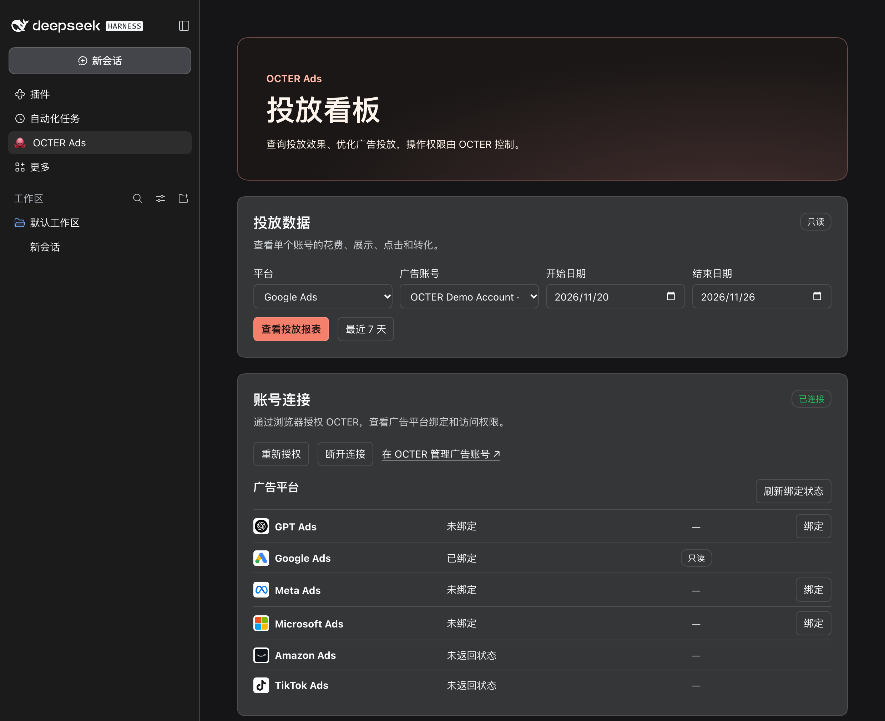
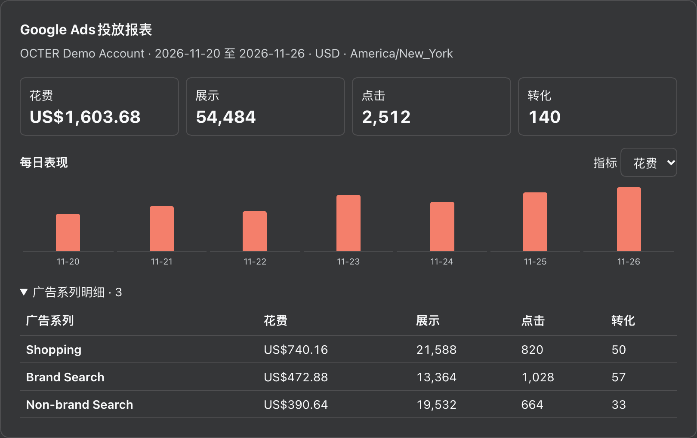

# OCTER Ads · DeepSeek Harness 插件


[English](README.en.md)

**永久免费的广告管理和优化插件。** 在 DeepSeek Harness 连接广告账号、生成投放报表、分析表现并制定优化方案。账号连接、数据查询和报表功能均可免费使用。实际投放费用由各广告平台结算。 [OCTER Ads 官网](https://ads-mcp.octer.ai/)

## 装好后能做什么

| 入口 | 功能 |
| --- | --- |
| **插件详情** | 授权 OCTER、绑定广告账号，查看各平台的连接状态和当前权限 |
| **左侧栏 OCTER Ads** | 按平台、账号和日期生成投放报表，查看花费、展示、点击、转化及广告系列明细 |
| **对话** | 用指标卡、趋势图和明细表呈现投放结果。比较两个周期，找出花费上升或转化下滑的广告系列，并给出优化建议 |
| **报表偏好** | 保存常用平台、账号和统计周期，方便重复查看周报或复盘同一账号 |

### 支持的广告平台

| 广告平台 |
| --- |
|  GPT Ads |
|  Google Ads |
|  Meta Ads |
|  Microsoft Ads |
|  Amazon Ads |
|  TikTok Ads |

连接账号后，可查询该平台返回的投放数据。报表维度、指标和可执行的广告操作取决于平台 API 与账号授权。

### API 权限控制

OCTER API 会按广告平台和账号校验权限。

| 权限 | 查询与分析 | 广告管理 |
| --- | --- | --- |
| **只读** | 查询账号、广告系列和投放报表，基于数据获取优化建议 | API 拒绝写入 |
| **读写** | 查询账号、广告系列和投放报表，基于数据获取优化建议 | 可执行平台支持且账号已授权的操作 |
| **未授权** | API 拒绝访问 | API 拒绝写入 |

## 界面预览

### 左侧栏投放看板



### 投放报表



截图使用模拟账号和投放数据。

## 安装

1. 在 DeepSeek Harness 打开「插件 → 添加插件」，粘贴 `https://github.com/octer-ai/octer-ads-dsh`。兼容 **0.2.2-rc.5** 和 **0.2.3-alpha.2**。
2. 打开左侧栏 **OCTER Ads**，点击「连接 OCTER」，在同一台电脑的浏览器完成授权。
3. 在 **OCTER** 绑定广告账号。GPT Ads 需要在 OCTER 绑定页填写 GPT Ads Manager 的 Advertiser API Key。

Web 版也可以用 CLI 安装：

```sh
dsh plugin --profile web add github:octer-ai/octer-ads-dsh
```

## 对话示例

- `ads` — 查看已绑定的平台。
- 「帮我绑定 GPT Ads」或「帮我连接 Google Ads、Meta Ads 和 Microsoft Ads」。
- 「把最近 7 天 Google Ads 的花费、点击和转化做成周报，用折线图展示每日趋势，并附上广告系列明细。」
- 「比较 Meta Ads 最近两周的花费和转化，找出花费上升但转化下滑的广告系列，给出优先排查的建议。」
- 「汇总 Amazon Ads 最近 30 天的投放效果，按广告系列列出花费和点击，并标出花费最高的广告系列。」
